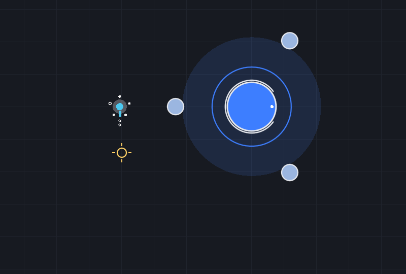

# Scriptshot

A top-down 2D twin-stick shooter, built in [Godot](https://godotengine.org/) 4.7.2, where you **script your own shots in Lua**. MIT licensed.

This is the **v0.1.0-demo**: a first playable slice you can finish in a sitting, plus the tools to rewrite your weapon and your dash.



## Play

- **[Play in the browser](https://karyu42.github.io/scriptshot/).**
- **[Download Linux, Windows, or web zips](https://github.com/Karyu42/scriptshot/releases/tag/v0.1.0-demo)** from the v0.1.0-demo release.

On Windows, the first launch may show SmartScreen ("Windows protected your PC"): choose **More info**, then **Run anyway**. The builds are unsigned. On Linux, `chmod +x Scriptshot.x86_64` after unzipping (the executable bit is often stripped), then run it.

## Controls

The game switches between mouse and gamepad from the last thing you touched.

| Action | Mouse + keyboard | Gamepad |
| --- | --- | --- |
| Move | `W` `A` `S` `D` | Left stick |
| Aim | Mouse | Right stick |
| Fire | Left mouse button | Right trigger |
| Dash | `Space` or `Shift` | `B` / Circle, or Right bumper |
| Open the script editor | `E` | `X` / Square |

Dash is a short burst (160 px, 0.2 s of invulnerability, 1.5 s cooldown). It goes the way you are moving, or the way you are aiming if you are standing still.

`F1` (Back / Select) toggles a bullet stress test; `F2` (`Y` / Triangle) cycles the target count. Those are for poking at performance, not for the slice.

## Script your shots (about a minute)

Press **E** (or **X** on a gamepad) to open the editor. Time drops to 15% while it is open; your ship does not move or fire while you type. **Ctrl+S** (or Ctrl+Enter) saves and reloads before the next shot; **Esc** closes the editor. Shots already in the air keep the code they were fired with. If a save has a mistake, the last good weapon keeps firing and the editor shows the problem.

You start with `shots/default.lua`, a single straight shot. *Insert starter…* drops in a ready-made weapon (Ctrl+Z undoes it). Each one marks a number with `<- tweak me`:

| Starter | What it does |
| --- | --- |
| Straight | One shot along your aim |
| Spread | Five shots in a fan |
| Spiral | Three arms that turn a little more every shot |
| Split | A hit bursts into pieces that fly back out |
| Homing | Shots steer toward the nearest enemy (locked until you earn `sense.nearest_enemy`) |

The file picker also has your **Dash** file (`abilities/dash.lua`). *Insert starter…* offers **Dash: Dash (built-in)** and **Dash: Time-stop dash**. Save to use it.

A smaller ship is harder to hit — `player.size` is 1 by default, and you can set it from any script (clamped to 0.25–4):

```lua
player.size = 0.4
```

The Time-stop dash starter freezes enemies and their bullets for a second (white-violet Null attacks still move at half speed), then dashes. Your ship and your own shots keep moving. A time stop does not make you invulnerable; `player:dash()` is what grants the short i-frames. This is a complete Dash file, shortened from the Time-stop dash starter:

```lua
return {
  on_dash = function(ctx, dir)
    world.time_stop(1.0)  -- at most 3 s; then it rests 1.5× as long (at least 1 s)
    player:dash(math.atan(dir.y, dir.x))
  end,
}
```

For the full Lua API, see [`docs/scripting/api.md`](docs/scripting/api.md) and the editor notes in [`docs/scripting/editor.md`](docs/scripting/editor.md).

## What's in this demo

A first-run ribbon, about **15–25 minutes** if you follow the on-screen hints:

- A starting room of practice dummies and short scripting lessons.
- A shielded dummy, then a field of regulars: Drifters, Swarmers, a Shieldbearer, and a Sniper.
- A rare elite, with an escort.
- **The Warden**, the slice boss: an armored core with a weak-point gap, and orbiting husks that heal it when they die. The fight has three phases. Beat the Warden to unlock `sense.enemies_in` and open a gate into the open world beyond.

`sense.nearest_enemy` unlocks after three kills (the practice dummies count). The in-game Codex shows a short page and a snippet for each Sense you earn.

You can already rewrite your weapon and your dash, including the size example and the Time-stop dash starter above. This demo does not include RPG mode, in-game script sharing, or spending shards.

## Known limits

- **Unsigned builds.** Windows will warn on first launch (SmartScreen: **More info > Run anyway**). There is no code-signed identity on these downloads.
- **No macOS build** in this release (an export preset exists for local experiments, but it is not shipped).
- **Android is untested.** An Android preset exists; do not expect a supported APK.
- This is an early demo. The on-screen HUD still shows developer stats (FPS, bullet counts, and similar).

## Build from source

You need **Godot 4.7.2** stable (the standard build, not .NET). Download it from <https://github.com/godotengine/godot/releases/tag/4.7.2-stable>. Put the editor on your `PATH` as `godot`, or point `$GODOT` at it. Lua scripting uses stock **[lua-gdextension 0.8.2](https://github.com/gilzoide/lua-gdextension/releases/tag/0.8.2)** (Lua 5.4).

```sh
./tools/ci/fetch_native_libs.sh   # downloads lua-gdextension 0.8.2 (binaries are gitignored)
godot --path .                    # runs scenes/main.tscn; or open project.godot and press F5
```

Optional: build the native bullet library (plain and `on_batch` shots use it when it loads; otherwise the game stays on GDScript). See [`docs/native.md`](docs/native.md) for pins and platforms.

```sh
./tools/build_native.sh           # Linux debug + release; also: linux, windows, macos, web, android
```

Committed export presets (`export_presets.cfg`) are `Windows Desktop`, `macOS`, `Linux`, `Web`, and `Android`. They write into the git-ignored `build/` folder, for example:

```sh
godot --headless --path . --export-release Linux build/linux/Scriptshot.x86_64
```

More export notes: [`docs/qa/release-builds.md`](docs/qa/release-builds.md).

### Tests

Unit and smoke tests use [GUT](https://github.com/bitwes/Gut) 9.7.1 (vendored in `addons/gut`):

```sh
./tools/run_tests.sh
# a subset: ./tools/run_tests.sh -gselect=bullet_pool
```

The bullet benchmark is `./tools/run_benchmark.sh`. Details and the backend switch are in [`docs/native.md`](docs/native.md). Contributor notes are in [`CONTRIBUTING.md`](CONTRIBUTING.md). Design docs live under [`docs/design/`](docs/design/).

## License

MIT, see [LICENSE](LICENSE). Vendored GUT is also MIT (`addons/gut/LICENSE.md`).
